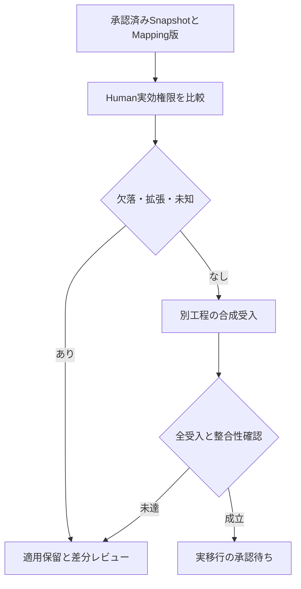

# S13 実装における読み方

承認済み判断は **Role=PRESERVE / Scope=HYBRID / Workload Identity=SEPARATE**。この先に保全した旧資料は、S13着手前の固定Sourceレビューです。旧資料内の「未実装」「0/99」「NOT_RUN」は当時の設計・正式移行試験の状態を表します。S13の実装と新しい自動試験結果は [仕様](OPERATIONAL_AUTHORIZATION_SPECIFICATION.md) と [検証報告](S13_VERIFICATION.md) で区別します。

S13では全99 Permission文字列を閉じたOperational Operation Catalogとして維持し、実際のRole内容・User Role割当からGrantを展開します。Role名だけの権限付与ではありません。以前のDIRECT66／SPLIT24／COMPOSITE4／REVIEW5は将来の細分化候補であり、S13の実装件数へ転用しません。実ルート未使用の5件も削除しません。

v2のGlobal権限をGlobalとして保持し、既存Handler/Storeの対象・所有・状態・Assignment・委任条件を残します。super_adminの割当時特例とRole作成/更新時の部分集合検証を区別します。Bootstrap／Trust Root／独立台帳／Recovery／鍵管理は含めません。

Permission入口175件、Any入口10件に加え、Session-only登録でHandlerがshow/hide権限を選ぶ PUT /streams/{id}/video-cover-state 1件にもOperational投影を適用します。登録構造とHandler内の正確な分岐は変更しません。ほかのSession-only経路、BのEvidence入口、Cの独立認可は維持します。

実DBのCustom Role、User割当、実ユーザー・実環境での移行は未取得・未実施です。Human PermissionをService Token、Host/Node/Worker/Updater/Local Executor資格へ変換しません。製品全体受入はNOT_RUN、Phase 1終了保留、本番移行未許可、正式v2復帰NOT_CERTIFIEDを維持します。

---

# Authority Migration Acceptance

作成日：2026-11-14 JST。読み取り専用レビュー用の**将来の受入試験計画**。

本資料はSource確認と設計案。実装・テスト・Build・CI・DB照会・Migration適用・実権限変更はいずれも未実施。

**実行結果：全ケースNOT_RUN。68件は計画ケース数であり、PASS件数ではない。** 既存工程のPASS数を合算していない。

## 1. 比較基準

- v2 CP：`93181192d8f036bae40b490957489c9ee8290769`（本番Go316＋SQL93を静的調査）。DefaultPermissions99、明示API261、追加Role/Store/Session/Service条件はV2_AUTHORITY_INVENTORY.mdとV2_PERMISSION_ROUTE_MATRIX.mdで固定。
- v3 CP：`d42a0fb2212c2378b822effc9b8dfd7031d457cb`、Contracts：`45aaa9932bcd92c728c86c95349853724fe1accc`、Updater：`cdc106ab795623e41e2fe42a73c598c782e5c8de`は現行モデルの参照基準。99 Permissionの移行実装が既に存在するとは扱わない。
- Mapping候補：DIRECT66、SPLIT24、COMPOSITE4、REVIEW5、EXCLUDED0、UNKNOWN0（99キー母数）。Humanではない実行資格のEXCLUDEDは別表であり加算しない。

## 2. 合格の定義

**設計案**：比較単位はPermissionの文字列数ではなく、`Actor × Operation × Resource/Scope × 状態 × 追加条件`。v2に存在したHuman業務認可の許可集合をA2、Mapping後の同じ意味のHuman許可集合をA3とする。対象/状態/認証条件が同じ入力について、原則`A2 = A3`を要求する。

- 減少：分割漏れ、対象Scopeの縮小、super_admin特例の欠落、OR→AND等として切替を停止。
- 増加：旧Permissionなしの操作、新しいTrust Root権限、他人所有Media、別組織Scope、条件抜け等として切替を停止。
- 新規v3固有機能は旧集合の比較に混入せず、独立承認・独立試験する。
- Humanが業務操作を要求できることと、Hostの実行資格成立は別。旧Grant再利用は禁止し、新しいv3 Evidence/Guard/Clock等が未接続ならUNKNOWN/HELDを保つ。Human能力維持を実環境Mutation許可と読み替えない。
- REVIEW5件は権限情報を保全しつつ実動作の新規許可を保留する。未実装キーが存在したことを理由に、別Permissionで許可されていた実動作を削除しない。

## 3. 検証データと実行条件（今後の工程）

この作業では実DB接続/データ取得をしていない。次工程で別途許可されたsnapshot又は使い捨て合成データから、最低限以下を構成する。Credentialや秘密本文は不要であり取得しない。

| 変数 | 必須の変種 |
| --- | --- |
| Actor | super_admin、全99を持つ非super_admin、限定Custom Role、複数Role、Roleなし、未認証、失効/disabled/locked/pending |
| User対象 | 自己、他人、別super_admin、最後のactive、他人のOAuth/MFA/Passkey |
| 業務対象 | 同CPの自分/他人作成Stream、別Host Node、primary/standby、未登録/無効/参照中/削除済、移行後新規対象 |
| 条件 | 必要Permissionの全組合せ、AND/OR欠落、型/Path/Method差、CSRF、Session期限、現在Revision、active work |
| 既存データ | User ID、Role ID/名称、role_permissions、user_roles、非秘密状態・参照、旧監査/Job記録 |
| 禁止データ | Password hashの外部持出し、raw token、Credential、Secret本文、実署名鍵、実Host接続 |

Source確認で見つかったv2 last-adminの非原子的部分やpending状態の保護範囲は、旧基準でPASSした保証に数えない。新しい移行/管理Transactionで必要な整合性対策は別の設計・受入項目として扱い、通常管理能力の削除によって代用しない。

## 4. 受入ケース一覧

| ID | 対象 | 期待結果 / 合格条件 | 今回の状態 |
| --- | --- | --- | --- |
| ID-01 | User ID / Principal | 同一CP内の全User ID対応が一対一。username/email変更でも主体不変。衝突・欠落は保留 | NOT_RUN |
| ID-02 | Account状態 | active/disabled/locked/pending_password_changeを保存。inactiveが権限を使えず、wrapped Routeのpending例外3経路が同じ（独自認証ceremonyは別判定） | NOT_RUN |
| ID-03 | OAuth本人対応 | Provider/subjectの結合を保持。email一致のみの別主体合併を拒否 | NOT_RUN |
| ROLE-01 | Role集合 | 全Role ID/名称/Permission集合とuser_rolesが入力snapshotから欠落しない | NOT_RUN |
| ROLE-02 | 複数Role | 互いに異なるPermissionを持つ2以上のRoleの和集合を維持。重複は権限増加にならない | NOT_RUN |
| ROLE-03 | Custom Role | 任意名Roleの実Permissionから展開。Role名からadmin/member等へ一括推定しない | NOT_RUN |
| ROLE-04 | 未知Permission | catalog外キー・wildcard・壊れた参照が入力にあればUNKNOWN/REVIEW。黙って削除・全権化しない | NOT_RUN |
| ROLE-05 | 99キーの閉包 | P001〜P099が全て1回以上移行定義に載り、DIRECT66/SPLIT24/COMPOSITE4/REVIEW5の母数99を検証 | NOT_RUN |
| ROLE-06 | Role無指定/空指定 | User更新のRoleIDs=nilと[]の意味、roles.assign条件を保持 | NOT_RUN |
| ROLE-07 | Role作成委譲 | actorの現在Permission部分集合だけRoleに設定可能。未知/非保持Permissionを拒否 | NOT_RUN |
| ROLE-08 | Role変更 | super_admin Roleの変更・削除を拒否。非super_adminの自己所属Role変更・削除拒否を維持 | NOT_RUN |
| ROLE-09 | User Role付与 | roles.assign欠落時はRole付きcreate/update拒否、Roleなしcreateは元通り許可 | NOT_RUN |
| ROLE-10 | 権限失効 | Role/Permission除去後の次要求を拒否。旧Sessionの権限キャッシュで継続不可 | NOT_RUN |
| SA-01 | super_adminの全既存能力 | 初期99と実snapshotの差を分け、対象super_adminの現在許可された全E操作を欠落なく移行 | NOT_RUN |
| SA-02 | 他super_admin管理 | 他super_adminのpassword/status/Role割当に関する特別条件を維持。単なる99 Permission保持者には同例外を追加しない | NOT_RUN |
| SA-03 | 自己User Role | actorがsuper_adminでも自己RoleIDs更新を拒否 | NOT_RUN |
| SA-04 | User削除 | 自己削除拒否、他super_admin保護、通常actorの対象Permission部分集合検証を維持 | NOT_RUN |
| SA-05 | 最後のactive管理者 | 単独disable/lock/delete/Role除去の既存拒否を比較。pending-password経路との違いも記録 | NOT_RUN |
| SA-06 | 同時管理者変更 | v2に原子的なlast-admin保証がない範囲を再現基準と区別し、新移行/管理Transactionでは全管理者喪失を防ぐ設計を個別検証 | NOT_RUN |
| SA-07 | 全対象範囲 | 既存の他人作成Stream、別HostのNode、別User等を扱う能力を保持。自己所有だけへ縮小しない | NOT_RUN |
| SA-08 | 新対象 | 同CPの既存管理範囲で作成された新対象も旧と同じ範囲で扱える。移行時IDだけの限定にしない | NOT_RUN |
| SA-09 | 新Trust権限非付与 | Bootstrap承認、Trust Root、独立台帳、Recovery quorum、署名Root/鍵、独立名簿はsuper_adminから自動付与しない | NOT_RUN |
| PASS-01 | 他人Password | 対象super_admin例外、通常actorの対象Permission部分集合、password policyを維持 | NOT_RUN |
| MFA-01 | 他人MFAの実範囲 | users.manage_mfaでOAuth link削除を保持。手動追加は拒否のまま。他人TOTP/passkey resetを新設しない | NOT_RUN |
| SELF-01 | Session-only操作 | 本人profile/avatar/email/preferences/passkey/MFA/OAuth link等の23空Permission入口を比較。対象Userをbodyで偽装不可 | NOT_RUN |
| HTTP-01 | Session/CSRF | 未認証・期限切れ・失効・disabled/locked拒否。unsafe CSRF欠落/誤値拒否。safe GETと区別 | NOT_RUN |
| HTTP-02 | OR/AND | 10 AnyPermissionはORのまま。Role付きUser・worker汎用割当・Token rotationの追加ANDを維持 | NOT_RUN |
| HTTP-03 | Method/Path | 261 Method/Pathとfactory展開、GET/HEAD、誤Method、未知Path、静的shellとAPI認可の分離を照合 | NOT_RUN |
| HTTP-04 | Contract boundary | Node Action projectionのmajor2必須、System Update個別codecのheader/厳格条件を維持 | NOT_RUN |
| HTTP-05 | Activation境界 | Node selection activation未完了時の503と限定Recovery要求。通過しても通常認証を省略しない | NOT_RUN |
| STREAM-01 | readの全意味 | 詳細/Runtime投影/preview/audio/event/encoder-preflight/YouTube通知と公開preview link発行を保持 | NOT_RUN |
| STREAM-02 | create/update分割 | 設定・visual・runtime適用・mark-failed・worker test・Assignmentの元の追加条件を全て維持 | NOT_RUN |
| STREAM-03 | start分割 | readiness、start、YouTube通知recoverを保持。readinessは実行予約ではない | NOT_RUN |
| STREAM-04 | stop分割 | 通常停止、force-stop、YouTube complete、relay-static recoveryを保持 | NOT_RUN |
| STREAM-05 | Cover権限 | active=trueはshow_cover、falseはhide_cover。両方AND又は一方で両方許可へ変換しない | NOT_RUN |
| STREAM-06 | Retry upload | streams.retry_uploadが実経路。未使用archives.retry_uploadだけのactorを新規許可しない | NOT_RUN |
| MEDIA-01 | 共有OR能力 | streams.createだけ、streams.updateだけ、両方、いずれもなしを比較。upload/session/variant/deleteを全て対象 | NOT_RUN |
| MEDIA-02 | Media所有Scope | 他人所有/不正Sessionを拒否。expiry/claim/retirementは操作別に比較。通常soft retirementは参照中も可能、scoped draft削除は未claim/session一致が必要。Stream参照previewの保持条件は別 | NOT_RUN |
| PROFILE-01 | 4 Profile family | encoder/archive/caption/overlay各5 Routeと16 Permissionを展開し、kind/IDの取り違えを拒否 | NOT_RUN |
| PROFILE-02 | Live caption | caption profile updateに伴うlive/starting参照Streamへの適用能力を保持 | NOT_RUN |
| PROFILE-03 | 更新競合/参照 | expected_updated_at/expected_revisionの競合、参照中削除/soft retirementの意味を保存 | NOT_RUN |
| SECRET-01 | Secret update | 許可nameの非空設定と空値clearをsecrets.updateで保持。未知name拒否、raw readへ昇格しない | NOT_RUN |
| SECRET-02 | 埋込秘密管理 | Discord/YouTube/App設定内の既存秘密write/clearを保持。不要だったsecrets.updateを追加して縮小しない | NOT_RUN |
| TOKEN-01 | 発行Scope | 全ServiceType/Scope allowlist、scopeごとのHuman Permissionを比較。Service Token ScopeをHuman Capabilityへ直結しない | NOT_RUN |
| TOKEN-02 | rotate再認可 | create+revoke、後継scopeの現在Permission、update_agent秘密条件、active workを維持 | NOT_RUN |
| TOKEN-03 | Node管理能力 | api_tokens.createに付随する一覧/登録/更新/configure/rotate/projectionを分割後も全て保持 | NOT_RUN |
| TOKEN-04 | pull_v2 rotation | legacy即時rotation拒否、staged rotation/所有世代/状態遷移を維持 | NOT_RUN |
| ASSIGN-01 | primary/standby | Assignment role・ServiceType・Stream/Service所属を保持。Human ACLとMachine primary資格を混同しない | NOT_RUN |
| ASSIGN-02 | Worker操作 | workers.assign/unassign専用入口とservices.assign/unassign経由の追加AND、restart flag、deleteのservices.disableを比較 | NOT_RUN |
| ARCH-01 | Archive分割 | read/artifact/shares、download/share作成、delete/rename/share失効の合計能力を維持 | NOT_RUN |
| ARCH-02 | 公開link | Archive shareのrevoked/expiry/allow_download、Preview署名のStream/期限/name等を維持。IDだけのアクセス不可 | NOT_RUN |
| INTEG-01 | OAuth管理 | 新規connectとreconnectのPermission差、state-cookie/provider/purpose/targetとcallback現在権限を維持 | NOT_RUN |
| INTEG-02 | 自動Provision Role | Provider autoProvision/defaultRole変更にroles.assignと委譲制約を維持。ログインだけでv3Rootを与えない | NOT_RUN |
| UPDATE-01 | execute分割 | 12 execute Route内のsoftware/Port mode分岐を含む14 Human Operation候補全ての合計を旧system_updates.executeと比較。Port contract v2のlocal_only/local_and_advertisedとsystemd/Docker、snapshot/endpoint/desired Revision/fence/port reservationを確認。generic update retryを架空追加しない | NOT_RUN |
| UPDATE-02 | Policy/Ownership | 有効Policy、release/channel/target、pull ownership、実行Hostとepoch、active work/Revision条件を保持 | NOT_RUN |
| UPDATE-03 | Rotation追加AND | system_updates.execute+api_tokens.create+api_tokens.revoke+secrets.updateを全て要求。cancel/emergencyの該当追加条件を比較 | NOT_RUN |
| UPDATE-04 | Host Bootstrap | 通常Host Bootstrap job作成能力とsecrets.update条件を保持。v3Root Bootstrap承認は与えない | NOT_RUN |
| UPDATE-05 | Self Update | create/retry/cancel/readとjob/binding/Host/ownership/期限等の条件を維持 | NOT_RUN |
| MACHINE-01 | 実行資格分離 | Service Token/Configure/Activation/Mutation Grant/Self Update Grant/Leaseを人間の権利から導出しない | NOT_RUN |
| MACHINE-02 | 旧資格非再利用 | 旧token/grant/lease/consume済記録を新v3実行資格として再発行/再活性化しない。履歴は保持 | NOT_RUN |
| OBS-01 | Observability | incidents/diagnostics/remediation/notification/metricsのHuman操作を保持。外部Service未接続なら成功扱いしない | NOT_RUN |
| DORMANT-01 | 未使用5キー | 旧Permission行を保全し、消去も新機能有効化も行わない。関連実動作の別Permissionも別途保持 | NOT_RUN |
| AUDIT-01 | 履歴保全 | 旧監査/Job/Receipt/Role履歴を変更しない。Migration版・入出力差分を新イベントへ。秘密やCredential不記録 | NOT_RUN |
| MIG-01 | 世代/CAS | 入力snapshot/Mapping版/現在認可世代不一致なら適用しない。部分Batch成功を許さない | NOT_RUN |
| MIG-02 | 再送/同時処理 | 同じ移行ID/内容は冪等、同ID異内容はCONFLICT。同時適用/複数processでも二重付与しない | NOT_RUN |
| MIG-03 | Commit不明 | ACK喪失・接続断・cancel・timeoutはUNKNOWNを保持。再付与前にdurable適用記録と権限stateを整合確認 | NOT_RUN |
| MIG-04 | Rollback | 欠落/拡張/監査失敗/未知stateで切替停止。補償記録を追記し旧資格を復活させない | NOT_RUN |
| MIG-05 | 本番非接続 | 実DB/Host/Provider/Credential・Migration適用・Deploy・Evidence発行を行わず受入NOT_RUNを維持 | NOT_RUN |

## 5. Source根拠と比較Oracle

| 領域 | 固定した一次Source |
| --- | --- |
| Permission集合 | [internal/security/permissions.go:3](https://github.com/Kome-Lab/Autostream-ControlPanel/blob/93181192d8f036bae40b490957489c9ee8290769/internal/security/permissions.go#L3) |
| Session/CSRF/OR | [internal/httpapi/server_request_auth.go:21](https://github.com/Kome-Lab/Autostream-ControlPanel/blob/93181192d8f036bae40b490957489c9ee8290769/internal/httpapi/server_request_auth.go#L21) [internal/httpapi/server_request_auth.go:48](https://github.com/Kome-Lab/Autostream-ControlPanel/blob/93181192d8f036bae40b490957489c9ee8290769/internal/httpapi/server_request_auth.go#L48) |
| User/Role特例 | [internal/httpapi/server_users_roles.go:120](https://github.com/Kome-Lab/Autostream-ControlPanel/blob/93181192d8f036bae40b490957489c9ee8290769/internal/httpapi/server_users_roles.go#L120) [internal/store/admin.go:58](https://github.com/Kome-Lab/Autostream-ControlPanel/blob/93181192d8f036bae40b490957489c9ee8290769/internal/store/admin.go#L58) |
| Permission合算 | [internal/store/auth_user_credentials_mariadb.go:112](https://github.com/Kome-Lab/Autostream-ControlPanel/blob/93181192d8f036bae40b490957489c9ee8290769/internal/store/auth_user_credentials_mariadb.go#L112) |
| last-admin範囲 | [internal/store/admin.go:218](https://github.com/Kome-Lab/Autostream-ControlPanel/blob/93181192d8f036bae40b490957489c9ee8290769/internal/store/admin.go#L218) [internal/store/admin.go:246](https://github.com/Kome-Lab/Autostream-ControlPanel/blob/93181192d8f036bae40b490957489c9ee8290769/internal/store/admin.go#L246) [internal/store/admin.go:293](https://github.com/Kome-Lab/Autostream-ControlPanel/blob/93181192d8f036bae40b490957489c9ee8290769/internal/store/admin.go#L293) |
| Assignment | [internal/database/migrations/008_service_assignment_roles.sql:1](https://github.com/Kome-Lab/Autostream-ControlPanel/blob/93181192d8f036bae40b490957489c9ee8290769/internal/database/migrations/008_service_assignment_roles.sql#L1) [internal/httpapi/server_stream_assignments.go:41](https://github.com/Kome-Lab/Autostream-ControlPanel/blob/93181192d8f036bae40b490957489c9ee8290769/internal/httpapi/server_stream_assignments.go#L41) |
| Secret埋込能力 | [internal/httpapi/server_discord_configs.go:129](https://github.com/Kome-Lab/Autostream-ControlPanel/blob/93181192d8f036bae40b490957489c9ee8290769/internal/httpapi/server_discord_configs.go#L129) [internal/httpapi/server_youtube_outputs.go:136](https://github.com/Kome-Lab/Autostream-ControlPanel/blob/93181192d8f036bae40b490957489c9ee8290769/internal/httpapi/server_youtube_outputs.go#L136) [internal/httpapi/server_settings.go:89](https://github.com/Kome-Lab/Autostream-ControlPanel/blob/93181192d8f036bae40b490957489c9ee8290769/internal/httpapi/server_settings.go#L89) |
| System Update Human/Machine | [internal/httpapi/server_routes_updater.go:1](https://github.com/Kome-Lab/Autostream-ControlPanel/blob/93181192d8f036bae40b490957489c9ee8290769/internal/httpapi/server_routes_updater.go#L1) [internal/database/migrations/041_system_update_mutation_grants.sql:1](https://github.com/Kome-Lab/Autostream-ControlPanel/blob/93181192d8f036bae40b490957489c9ee8290769/internal/database/migrations/041_system_update_mutation_grants.sql#L1) |
| v3現在の限界 | [internal/v3authorization/types.go:13](https://github.com/Kome-Lab/Autostream-ControlPanel/blob/d42a0fb2212c2378b822effc9b8dfd7031d457cb/internal/v3authorization/types.go#L13) [internal/v3authorization/management_types.go:14](https://github.com/Kome-Lab/Autostream-ControlPanel/blob/d42a0fb2212c2378b822effc9b8dfd7031d457cb/internal/v3authorization/management_types.go#L14) |
| C10 Preflight非実行資格 | [internal/localexecutor/registry/preflight.go:8](https://github.com/Kome-Lab/Autostream-Updater/blob/cdc106ab795623e41e2fe42a73c598c782e5c8de/internal/localexecutor/registry/preflight.go#L8) |

今後の試験は固定v2 Sourceを独立Oracleとする。新旧が同じ新Mapping関数を呼んで一致するだけの自己比較では不足。Handler追加条件とStoreの現在状態も入力に含め、Sourceで確認した未実装/常時拒否経路は成功期待値にしない。

## 6. 移行差分の判定・監査

**設計案**：各Principalについて旧Permission集合、Role由来の特別条件、対象範囲、候補Capability/Operation集合を計算し、差分を固定Codeに分ける。

| 差分Code候補 | 内容 | 処理 |
| --- | --- | --- |
| MISSING_OPERATION | 旧許可操作の分割漏れ | 切替停止、Mapping修正 |
| SCOPE_NARROWED / WIDENED | 自己限定への縮小、別組織等への拡大 | 切替停止、Source条件へ戻す |
| BOOLEAN_CHANGED | OR/AND、nil/empty等の意味変化 | 切替停止 |
| SPECIAL_ROLE_CHANGED | super_admin例外又は保護の喪失/拡張 | 切替停止、明示再レビュー |
| UNKNOWN_ENTITLEMENT | 実DBに未知Permission/参照 | 当該単位保留、推測変換しない |
| ROOT_AUTHORITY_ADDED | 新Bootstrap/Root/独立Recovery等の自動付与 | 拒否、独立承認へ分離 |
| EXECUTION_AUTHORITY_REUSED | 旧Token/Grant/Leaseの再利用 | 拒否、旧記録は保全 |
| STORAGE_OUTCOME_UNKNOWN | commit結果不明/監査不整合 | UNKNOWN、再付与停止、durable状態照合 |

監査はSource commit、Mapping版、snapshot識別子、Principal ID、Role ID、旧/新の非秘密権限集合、差分Code、移行ID、結果を記録する案とする。旧監査/履歴を書換えない。root秘密や認証payloadを監査に複製しない。

## 7. 適用前ゲートとRollback

現時点は設計レビューのみ。次工程の実装・合成試験、その後の実環境切替はそれぞれ別の許可が必要。Repository/CI変更は今回行っていない。

**Rollback開始条件（設計）**：権限の欠落/予期しない増加、監査失敗、部分適用、Revision不一致、適用記録と実状態不一致、commit不明、全管理者喪失の恐れ、旧Execution Authority再利用の検出。

Rollbackは新規変更の停止、現状態/監査の保全、durable適用記録確認、承認された補償操作の順に行う。古いDB backupへ戻しただけで移行Markerや権限の現在性を成立としない。UNKNOWNからの自動再付与・Bootstrap再実行・旧Grant再利用を禁止する。補償操作自体も現在認可と監査を必要とし、その実装方式は未決定。

## 8. 今回の実施・未実施と次の最小工程

**実施**：固定Source取得/識別照合、Go/SQL静的調査、全99キーと261 Routeの資料化、super_admin特殊条件/実装限界の記録、v3論理Mapping候補と受入計画の作成。

**未実施**：Go変更、Build/Test/Race/CI、実DB参照・実ユーザー棚卸し、Migration変更/適用、権限移行/Bootstrap、Host/Provider接続、Deploy、実Evidence発行。

次の最小工程は、4資料のレビューで(1)新Human Scope/catalog、(2)super_admin業務特例表現、(3)REVIEW5キー保全、(4)差分時保留/復旧単位を決め、**合成データ上で実効権限比較を実装する依頼**を確定すること。v3 Root/Bootstrap/Recoveryの承認は別工程として残す。

実Evidence発行無効／全量PRESERVE／旧Execution Authority非再利用／自動開始保留維持／UNKNOWN・HELD非成功化／製品全体受入NOT_RUN／Phase 1終了保留／本番移行未許可／正式v2復帰NOT_CERTIFIED。

注：Connected Accountの開始actor ID一致やv2業務変更と監査の原子性は、旧Sourceが持つ保証として扱わない。強化する場合は既存Human能力維持と区別してレビューする。
